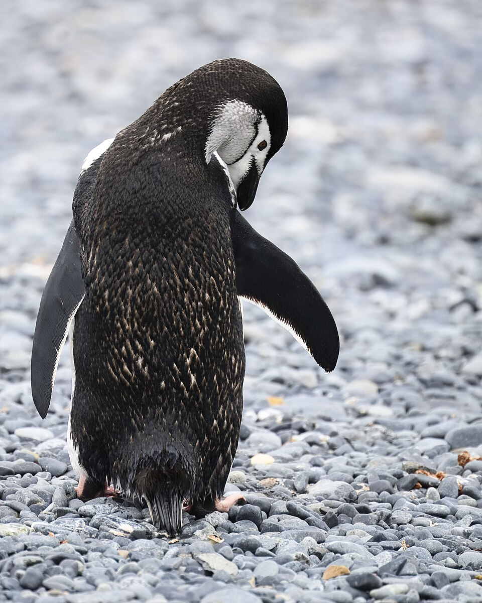
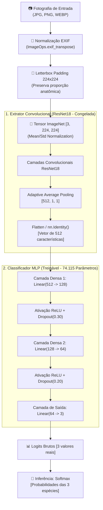
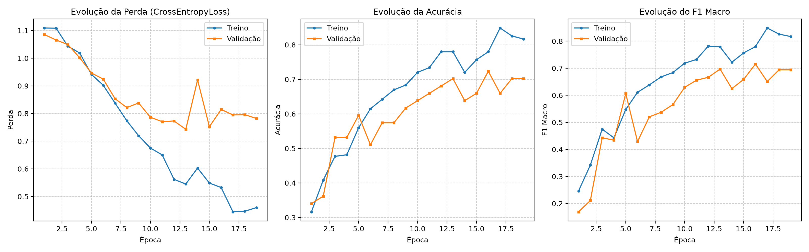
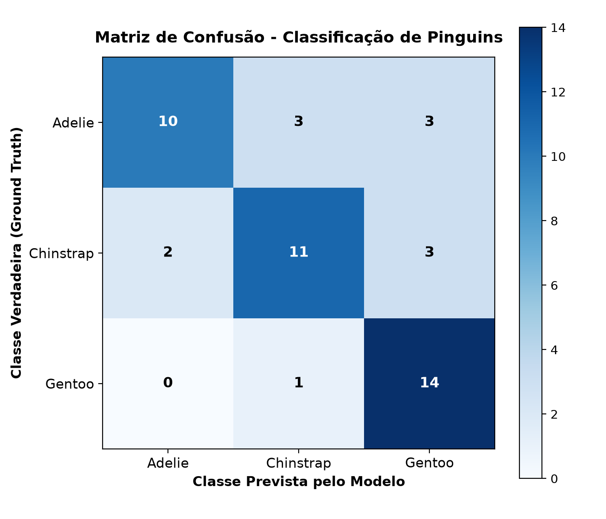

<div align="center">

# 🐧 Classificação de Espécies de Pinguins com CNN + MLP

### *Deep Learning aplicado à Visão Computacional e Taxonomia de Aves Antárticas*

[](https://www.python.org/)
[](https://pytorch.org/)
[](LICENSE)
[-brightgreen?logo=pytest&logoColor=white)](tests/)
[](#2-arquitetura-do-sistema-e-fluxo-de-dados)
[](#)

<p align="center">
  <b>Um pipeline científico completo de classificação de três espécies de pinguins antárticos (<i>Adelie</i>, <i>Chinstrap</i> e <i>Gentoo</i>) combinando um extrator convolucional profundo pré-treinado (<a href="https://pytorch.org/vision/main/models/generated/torchvision.models.resnet18.html">ResNet-18</a>) a uma rede neural densa multicamadas (<a href="src/penguin_mlp/model.py">Multilayer Perceptron - MLP</a>) implementada em PyTorch.</b>
</p>

---

| Pinguim-de-Adélia (*Adelie*) | Pinguim-de-Barbicha (*Chinstrap*) | Pinguim-Gentoo (*Gentoo*) |
| :---: | :---: | :---: |
|  |  |  |
| **Classe `0`** • *Pygoscelis adeliae* | **Classe `1`** • *Pygoscelis antarcticus* | **Classe `2`** • *Pygoscelis papua* |

</div>

---

## 📌 Índice

- [1. Visão Geral e Papel das Redes](#1-visão-geral-e-papel-das-redes)
- [2. Arquitetura do Sistema e Fluxo de Dados](#2-arquitetura-do-sistema-e-fluxo-de-dados)
- [3. Resultados Experimentais e Métricas](#3-resultados-experimentais-e-métricas)
- [4. Tecnologias Utilizadas](#4-tecnologias-utilizadas)
- [5. Instalação e Configuração](#5-instalação-e-configuração)
- [6. Guia Rápido de Uso](#6-guia-rápido-de-uso)
  - [6.1. Inferência em Imagem Única](#61-inferência-em-imagem-única)
  - [6.2. Inferência em Lote (Pasta)](#62-inferência-em-lote-pasta)
  - [6.3. Treinamento da MLP](#63-treinamento-da-mlp)
  - [6.4. Configuração Simplificada via `mlp_params.py`](#64-configuração-simplificada-via-mlp_paramspy)
  - [6.5. Avaliação no Conjunto de Teste](#65-avaliação-no-conjunto-de-teste)
  - [6.6. Demonstração de Backpropagation Manual em NumPy](#66-demonstração-de-backpropagation-manual-em-numpy)
  - [6.7. Execução dos Testes Automatizados](#67-execução-dos-testes-automatizados)
- [7. Dataset e Saneamento](#7-dataset-e-saneamento)
- [8. Estrutura do Repositório](#8-estrutura-do-repositório)
- [9. Fundamentação Teórica](#9-fundamentação-teórica)
- [10. Documentação Complementar](#10-documentação-complementar)
- [11. Licença e Autoria](#11-licença-e-autoria)

---

## 1. Visão Geral e Papel das Redes

O projeto aborda a classificação taxonômica em imagens reais com rigor científico, reprodutibilidade e foco pedagógico para Ciência da Computação. O pipeline divide a responsabilidade em dois componentes desacoplados:

1. **CNN (ResNet18 Convolucional Pré-treinada):**
   - Atua como **extratora fixa de características visuais de alto nível** (*Feature Extractor*).
   - Todos os 11.176.512 parâmetros permanecem **estritamente congelados** (`requires_grad = False`).
   - Mapeia qualquer imagem normalizada de tamanho 224×224 para um vetor latente denso de **512 características**.
   - *A CNN não classifica as espécies nem substitui a MLP.*

2. **MLP (Multilayer Perceptron Treinada em PyTorch):**
   - Rede neural que **efetivamente aprende** a tarefa de discriminação entre as 3 espécies.
   - Recebe o vetor de 512 dimensões e mapeia as fronteiras não-lineares via retropropagação (*Backpropagation*) e otimizador `AdamW`.
   - Arquitetura: `Linear(512 -> 128) -> ReLU -> Dropout(0.3) -> Linear(128 -> 64) -> ReLU -> Dropout(0.2) -> Linear(64 -> 3)`.
   - Total de parâmetros treináveis: **74.115 parâmetros**.

### Espécies Classificadas e Mapeamento Canônico

| ID Numérico | Espécie | Nome Popular | Nome Científico | Características Visuais Típicas |
|:---:|---|---|---|---|
| **`0`** | **Adelie** | Pinguim-de-adélia | *Pygoscelis adeliae* | Anel branco circular ao redor do olho, bico preto curto. |
| **`1`** | **Chinstrap** | Pinguim-de-barbicha | *Pygoscelis antarcticus* | Linha preta distintiva sob o queixo ("barbicha"), face branca. |
| **`2`** | **Gentoo** | Pinguim-gentoo | *Pygoscelis papua* | Mancha triangular branca sobre a cabeça unindo os olhos, bico avermelhado. |

> [!NOTE]
> **Paradigma de Mundo Fechado (*Closed-Set*):** O modelo opera sob a premissa de três espécies antárticas. Ao receber animais externos (ex: foca, pinguim-imperador), o sistema utiliza um **limiar de confiança configurável (padrão: 60%)** para alertar sobre classificações incertas.

---

## 2. Arquitetura do Sistema e Fluxo de Dados



---

## 3. Resultados Experimentais e Métricas

Avaliação independente conduzida no subconjunto de **teste intocado** (47 amostras balanceadas, semente `42`):

| Métrica Global | Valor Obtido |
|---|:---:|
| **Acurácia Global (*Accuracy*)** | **74.47%** (35 / 47 acertos) |
| **F1-Score Macro** | **0.7413** |
| **Precisão Média Ponderada** | **75.67%** |
| **Revocação Média Ponderada** | **74.47%** |

### Desempenho por Espécie

| Espécie | Suporte (*N*) | Precisão (*Precision*) | Revocação (*Recall*) | F1-Score |
|---|:---:|:---:|:---:|:---:|
| **Adelie** | 16 | **83.33%** | 62.50% | 0.7143 |
| **Chinstrap** | 16 | **73.33%** | 68.75% | 0.7097 |
| **Gentoo** | 15 | **70.00%** | **93.33%** | **0.8000** |

### Visualizações do Experimento

| Curvas de Treinamento e Validação | Matriz de Confusão no Conjunto de Teste |
| :---: | :---: |
|  |  |
| *Evolução de Perda (Cross-Entropy) e F1-Macro ao longo das épocas com Early Stopping na época 13.* | *Desempenho no teste independente (47 amostras). Notável sensibilidade para a classe Gentoo (93.3%).* |

---

## 4. Tecnologias Utilizadas

- **Linguagem:** [Python 3.10+](https://www.python.org/) (testado integralmente no Python 3.13)
- **Deep Learning:** [PyTorch](https://pytorch.org/) (Criação da MLP, Autograd, Backpropagation e Tensores)
- **Visão Computacional:** [TorchVision](https://pytorch.org/vision/) (Pesos pré-treinados ResNet18) e [Pillow](https://python-pillow.org/) (Letterboxing e correção EXIF)
- **Cálculo Científico:** [NumPy](https://numpy.org/) e [scikit-learn](https://scikit-learn.org/) (Divisão estratificada, métricas e matriz de confusão)
- **Visualização Gráfica:** [Matplotlib](https://matplotlib.org/) (Curvas de treino e matriz de confusão)
- **Detecção de Duplicatas:** [ImageHash](https://github.com/JohannesBuchner/imagehash) (Hash perceptual pHash)
- **Engenharia de Software:** [pytest](https://pytest.org/) (16 testes unitários e de integração automatizados)

---

## 5. Instalação e Configuração

### Pré-requisitos
- Python 3.10 ou superior instalado no sistema.
- Gerenciador de pacotes `pip` atualizado.

### 🐧 Instalação no Windows (PowerShell)

```powershell
# 1. Clonar o repositório
git clone https://github.com/patr0ka/MLP_Penguin.git
cd MLP_Penguin

# 2. Criar e ativar o ambiente virtual
python -m venv .venv
.\.venv\Scripts\Activate.ps1

# 3. Instalar o pacote em modo editável com dependências
python -m pip install --upgrade pip
python -m pip install -e .
```

### 🐧 Instalação no Linux / macOS (Bash)

```bash
# 1. Clonar o repositório
git clone https://github.com/patr0ka/MLP_Penguin.git
cd MLP_Penguin

# 2. Criar e ativar o ambiente virtual
python3 -m venv .venv
source .venv/bin/activate

# 3. Instalar o pacote em modo editável com dependências
python -m pip install --upgrade pip
python -m pip install -e .
```

> **Aceleração por Hardware:** O código detecta GPU (CUDA) automaticamente caso disponível; caso contrário, executa com alta velocidade em CPU.

---

## 6. Guia Rápido de Uso

### 6.1. Inferência em Imagem Única

Classifique qualquer foto de pinguim apontando o caminho da imagem:

```bash
python -m penguin_mlp.predict --image "data/to_predict/sample_adelie.jpg"
```

**Exemplo de saída no terminal:**
```text
============================================================
Imagem: data\to_predict\sample_adelie.jpg
------------------------------------------------------------
Espécie prevista: Adelie (Confiança: 91.45%)

Probabilidades estimadas por classe:
  - Adelie    :  91.45% -> [PREVISTA]
  - Chinstrap :   5.23%
  - Gentoo    :   3.32%

Nota: As probabilidades representam a saída do classificador fechado,
não uma garantia absoluta de identificação biológica em ambiente selvagem.
============================================================
```

### 6.2. Inferência em Lote (Pasta)

Processe dezenas ou centenas de imagens de uma vez e exporte uma planilha CSV consolidada:

```bash
python -m penguin_mlp.predict_folder --folder "data/to_predict" --output-csv "artifacts/metrics/batch_predictions.csv"
```

### 6.3. Treinamento da MLP

Treine a rede neural utilizando as características extraídas pela ResNet18:

```bash
python -m penguin_mlp.train
```

O treinamento executa validação contínua, salva automaticamente o checkpoint de melhor desempenho em `artifacts/checkpoints/best_model.pt` e gera o gráfico de evolução em `artifacts/metrics/training_curves.png`.

### 6.4. Configuração Simplificada via `mlp_params.py`

Você não precisa alterar o código fonte interno para experimentar diferentes arquiteturas. Basta editar o arquivo [`mlp_params.py`](mlp_params.py) na raiz do projeto:

```python
# mlp_params.py
HIDDEN_DIM_1 = 128     # Neurônios da 1ª camada oculta
HIDDEN_DIM_2 = 64      # Neurônios da 2ª camada oculta
DROPOUT_1 = 0.30       # Regularização Dropout camada 1
DROPOUT_2 = 0.20       # Regularização Dropout camada 2
LEARNING_RATE = 0.001  # Taxa de aprendizado inicial
EPOCHS = 40            # Número máximo de épocas
PATIENCE = 6           # Parada antecipada (Early Stopping)
```

### 6.5. Avaliação no Conjunto de Teste

Gere as métricas científicas completas e a matriz de confusão sobre o split de teste:

```bash
python -m penguin_mlp.evaluate
```

Arquivos gerados em `artifacts/metrics/`:
- `metrics.json`
- `classification_report.txt`
- `confusion_matrix.png`

### 6.6. Demonstração de Backpropagation Manual em NumPy

Para compreender como os gradientes são derivados analiticamente via Regra da Cadeia sem caixas pretas:

```bash
python examples/manual_backprop_demo.py
```

O script calcula as derivadas manuais e valida contra:
1. **Diferenças Finitas (*Gradient Checking*):** Erro relativo $\approx 10^{-10}$.
2. **Autograd do PyTorch:** Erro relativo $\approx 10^{-8}$ (equivalência exata).

### 6.7. Execução dos Testes Automatizados

Valide a integridade do código, tensores e inferência com o pytest:

```bash
pytest -v
```

```text
tests/test_data.py ......                                                [ 37%]
tests/test_inference.py ....                                             [ 62%]
tests/test_model.py ......                                               [100%]
============================= 16 passed in 13.63s =============================
```

---

## 7. Dataset e Saneamento

- **Fonte Primária:** Fotografias com licenças livres Creative Commons (CC BY-SA / Domínio Público) coletadas do Wikimedia Commons das categorias `Pygoscelis_adeliae`, `Pygoscelis_antarcticus` e `Pygoscelis_papua`.
- **Pipeline de Higienização:**
  - Validação de formato e cabeçalhos EXIF;
  - Eliminação de duplicatas exatas via hash SHA-256;
  - Detecção e descarte de duplicatas quase idênticas via hash perceptual pHash;
  - **Total de 312 imagens retidas:** 105 Adelie, 105 Chinstrap, 102 Gentoo.
  - Divisão estratificada (seed 42): **70% Treino (218)**, **15% Validação (47)** e **15% Teste (47)**.

---

## 8. Estrutura do Repositório

```text
MLP_Penguin/
├── README.md                          # Guia visual completo do projeto
├── mlp_params.py                      # Configuração simplificada dos hiperparâmetros
├── requirements.txt                   # Dependências diretas do projeto
├── pyproject.toml                     # Metadados do pacote Python e configuração do pytest
├── .gitignore                         # Exclusão de caches, ambientes e temporários
├── configs/
│   └── default.yaml                   # Configurações padrão centralizadas
├── data/
│   ├── raw/                           # Imagens originais (Adelie, Chinstrap, Gentoo)
│   ├── splits/                        # Manifestos e divisões de treino/val/teste (CSV)
│   ├── to_predict/                    # Fotografias de exemplo para inferência
│   └── external_test/                 # Imagens de teste fora de domínio (Out-of-Distribution)
├── artifacts/
│   ├── checkpoints/                   # Checkpoint salvo (best_model.pt)
│   └── metrics/                       # Gráficos, matriz de confusão e relatórios
├── docs/
│   ├── architecture.md                # Detalhes aprofundados da CNN e MLP
│   ├── dataset.md                     # Metadados de proveniência, licenças e curadoria
│   ├── backpropagation.md             # Demonstração matemática completa das derivadas
│   └── troubleshooting.md            # Guia de dúvidas e resolução de erros
├── examples/
│   └── manual_backprop_demo.py        # Demonstração didática de Backpropagation em NumPy
├── src/
│   └── penguin_mlp/
│       ├── __init__.py                # Ponto de entrada do módulo
│       ├── config.py                  # Dataclasses de configuração com tipagem estática
│       ├── data.py                    # Dataset PyTorch e geradores DataLoader
│       ├── transforms.py              # Letterbox proporcional e aumentação de dados
│       ├── backbone.py                # Extração com ResNet-18 e congelamento de gradientes
│       ├── model.py                   # Arquitetura modular da rede MLP
│       ├── download_dataset.py        # Coleta automatizada com verificação de licença
│       ├── prepare_data.py            # Higienização por pHash e divisão estratificada
│       ├── train.py                   # Loop de treinamento com validação e Early Stopping
│       ├── evaluate.py                # Avaliação de métricas no conjunto de teste
│       ├── predict.py                 # Inferência em imagem individual
│       ├── predict_folder.py          # Processamento em lote com exportação CSV
│       └── utils.py                   # Gestão de seeds, dispositivos e checkpoints
└── tests/
    ├── test_data.py                   # Testes de carga, integridade e ausência de vazamento
    ├── test_model.py                  # Testes da topologia, contagem de pesos e gradientes
    └── test_inference.py              # Testes de predição, formatos e tratamento de erros
```

---

## 9. Fundamentação Teórica

- **Neurônio Artificial:** Unidade elementar que calcula a combinação linear $z = \mathbf{w}^T \mathbf{x} + b$ e projeta o resultado através de uma função de ativação não-linear $a = f(z)$.
- **Ativação ReLU:** $f(z) = \max(0, z)$. Elimina a saturação de gradientes positivos e permite o treinamento estável de múltiplas camadas.
- **Dropout:** Técnica estocástica de regularização que desativa temporariamente uma porcentagem dos neurônios durante o treino, impedindo a co-adaptação e o *overfitting*.
- **Logits e Softmax:** Transforma números reais irrestritos em probabilidades normalizadas somando 1:
  $$p_k = \frac{e^{z_k}}{\sum_{j=1}^{C} e^{z_j}}$$
- **Cross-Entropy Loss:** Penaliza a divergência entre a distribuição prevista e o rótulo verdadeiro:
  $$\mathcal{L} = -\sum_{c=1}^{C} y_c \log(p_c)$$
- **Retropropagação (*Backpropagation*):** Aplicação recursiva da Regra da Cadeia para propagar o gradiente do erro da camada de saída até as primeiras conexões:
  $$\frac{\partial \mathcal{L}}{\partial \mathbf{W}} = \frac{\partial \mathcal{L}}{\partial \mathbf{z}} \cdot \mathbf{a}_{\text{anterior}}^T$$
- **Otimizador AdamW:** Otimizador adaptativo que combina momento de primeira e segunda ordem com decaimento desacoplado de pesos (*weight decay*).

---

## 10. Documentação Complementar

Para aprofundar nos fundamentos teóricos e detalhes de implementação:

- 📐 [**Arquitetura do Sistema**](docs/architecture.md): Detalhamento do extrator ResNet18, normalização Letterbox e MLP.
- 🧮 [**Matemática do Backpropagation**](docs/backpropagation.md): Dedução passo a passo de todas as derivadas parciais e matriz jacobiana.
- 🗃️ [**Curadoria do Dataset**](docs/dataset.md): Licenças, fontes e estratégia de saneamento com perceptual hash.
- 🛠️ [**Guia de Solução de Problemas**](docs/troubleshooting.md): Resoluções para dúvidas comuns de execução e ambiente.

---

## 11. Licença e Autoria

Este projeto foi desenvolvido por **Patrick** para a disciplina de **Inteligência Artificial II** do curso de Ciência da Computação na **Universidade Estadual do Centro-Oeste (Unicentro)**.

Distribuído sob a licença **MIT**. Consulte o arquivo [LICENSE](LICENSE) para obter mais informações.

<div align="center">
  <sub>Desenvolvido com carinho para a disciplina de Inteligência Artificial II • Unicentro</sub>
</div>
