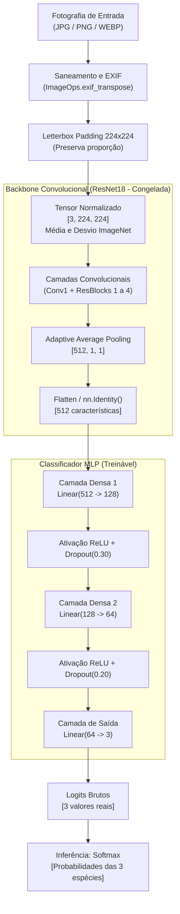

# Arquitetura do Sistema: CNN (ResNet18) + MLP Classificadora

Este documento detalha as decisões arquiteturais, o fluxo de tensores, o papel de cada componente e a contagem analítica de parâmetros do classificador de espécies de pinguins (*Pygoscelis adeliae*, *Pygoscelis antarcticus* e *Pygoscelis papua*).

---

## 1. Visão Geral e Princípio de Separação de Papéis

O projeto adota uma arquitetura em dois blocos funcionais rigorosamente desacoplados:

1. **Extrator de Características Visuais (Backbone Convolucional):**
   - Utiliza uma **ResNet18** pré-treinada na base ImageNet (1.28 milhão de imagens, 1000 classes).
   - Atua exclusivamente no modo de inferência congelado (`cnn.eval()`, `requires_grad = False`).
   - Mapeia uma imagem pré-processada de resolução \(3 \times 224 \times 224\) para um vetor latente e invariante de **512 características densas**.
   - **A CNN não é re-treinada nem ajustada (fine-tuning) na primeira versão.**

2. **Classificador Específico do Domínio (Multilayer Perceptron - MLP):**
   - Rede neural densa multicamadas desenvolvida e treinada do zero para este projeto.
   - Recebe o vetor de 512 dimensões e aprende as fronteiras de decisão não-lineares para discriminar as três espécies.
   - Produz os logits de classificação para as classes `Adelie` (0), `Chinstrap` (1) e `Gentoo` (2).

---

## 2. Por que Usar Pré-treinamento e Congelamento?

O treinamento de uma rede convolucional profunda do zero exige dezenas de milhares de imagens rotuladas e poder computacional intensivo (GPUs de alta performance). No problema de identificação biológica com poucas centenas de imagens reais disponíveis:
- Redes treinadas do zero tendem a sofrer de *overfitting* severo (memorização dos fundos de gelo/rocha em vez do animal).
- A **ResNet18** já aprendeu filtros de Gabor, detectores de contorno, texturas de penas, formatos de bico e anatomia geral em milhões de fotografias do ImageNet.
- O congelamento da CNN garante estabilidade numérica absoluta: a MLP atua como um classificador ótimo sobre representações visuais ricas já estabelecidas.

### Diferenças Técnicas no PyTorch:
- `cnn.eval()`: Desativa o comportamento estocástico do Dropout e fixa o cálculo de médias e variâncias móveis do BatchNorm.
- `param.requires_grad = False`: Informa ao grafo de diferenciação computacional que nenhuma derivada deve ser acumulada nos tensores da CNN.
- `with torch.no_grad()`: Desliga o rastreador de operações (grafo autograd), economizando memória RAM e ciclos de CPU durante a passagem pela CNN.

---

## 3. O Pipeline de Pré-processamento e o Algoritmo Letterbox

Fotografias de vida selvagem possuem razões de aspecto heterogêneas (panorâmicas, retratos verticais, enquadramentos 16:9 ou 4:3). 

### O Risco do Center Crop Tradicional
Um corte central simples corta até 40% das bordas da imagem. Em fotografias onde o pinguim está na beira da água, abaixado ou caminhando na lateral, o animal tem sua cabeça ou bico decepados, inviabilizando a identificação da espécie.

### A Solução Letterbox Implementada
1. Redimensiona a fotografia proporcionalmente pelo maior lado até 224 pixels:
   $$\text{escala} = \frac{224}{\max(L, A)}$$
2. Centraliza a imagem redimensionada em uma tela quadrada neutra de \(224 \times 224\) pixels preenchida com a cor média padrão \((124, 116, 104)\).
3. Converte os pixels para ponto flutuante no intervalo \([0.0, 1.0]\).
4. Aplica a normalização padrão ImageNet:
   $$\mathbf{x}_{\text{norm}} = \frac{\mathbf{x} - \boldsymbol{\mu}}{\boldsymbol{\sigma}}$$
   Onde \(\boldsymbol{\mu} = [0.485, 0.456, 0.406]\) e \(\boldsymbol{\sigma} = [0.229, 0.224, 0.225]\).

---

## 4. Estrutura Matemática da MLP e Neurônios Artificiais

### 4.1. O que é um Neurônio Artificial?
Um neurônio artificial na camada densa calcula a soma ponderada de todas as entradas, acrescida de um termo de viés (*bias*):
$$z = \sum_{i=1}^{n} w_i x_i + b = \mathbf{w}^T \mathbf{x} + b$$
E passa o resultado por uma função de ativação não-linear:
$$a = f(z)$$

- **Pesos (\(w_i\)):** Controlam a magnitude e o sinal da influência de cada característica visual.
- **Viés (\(b\)):** Desloca o limiar de ativação do neurônio independentemente das entradas.

### 4.2. Ativação ReLU (Rectified Linear Unit)
$$f(z) = \max(0, z)$$
A ReLU introduz não-linearidade permitindo que a rede aproxime superfícies de decisão complexas. Sem ativações não-lineares, uma composição de camadas densas seria algebricamente equivalente a uma única multiplicação matricial:
$$W_2 (W_1 \mathbf{x} + \mathbf{b}_1) + \mathbf{b}_2 = (W_2 W_1)\mathbf{x} + (W_2 \mathbf{b}_1 + \mathbf{b}_2) = \tilde{W}\mathbf{x} + \tilde{\mathbf{b}}$$

### 4.3. Dropout
Durante o treinamento, cada neurônio oculto tem uma probabilidade \(p\) de ser temporariamente desativado (zerado). No código:
- Camada 1: \(p = 0.30\)
- Camada 2: \(p = 0.20\)
Isso força a rede a aprender representações distribuídas e redundantes, impedindo que neurônios vizinhos dependam excessivamente uns dos outros (*co-adaptação*).

---

## 5. Contagem Analítica de Parâmetros

Para uma camada linear que mapeia de \(D_{\text{in}}\) para \(D_{\text{out}}\), a quantidade de parâmetros é dada por:
$$P = (D_{\text{in}} \times D_{\text{out}}) + D_{\text{out}}$$

| Camada | Operação | Dimensão Entrada | Dimensão Saída | Pesos (Weights) | Vieses (Biases) | Total de Parâmetros |
|---|---|---|---|---|---|---|
| **Densa 1** | `Linear(512, 128)` | 512 | 128 | \(512 \times 128 = 65.536\) | 128 | **65.664** |
| Ativação | `ReLU` + `Dropout(0.3)` | 128 | 128 | 0 | 0 | 0 |
| **Densa 2** | `Linear(128, 64)` | 128 | 64 | \(128 \times 64 = 8.192\) | 64 | **8.256** |
| Ativação | `ReLU` + `Dropout(0.2)` | 64 | 64 | 0 | 0 | 0 |
| **Saída** | `Linear(64, 3)` | 64 | 3 | \(64 \times 3 = 192\) | 3 | **195** |
| **Total MLP** | — | — | — | **73.920** | **195** | **74.115** |

- **Total de Parâmetros Treináveis na MLP:** **74.115**
- **Total de Parâmetros Congelados na CNN:** **11.176.512**
- **Total do Sistema:** **11.250.627**
